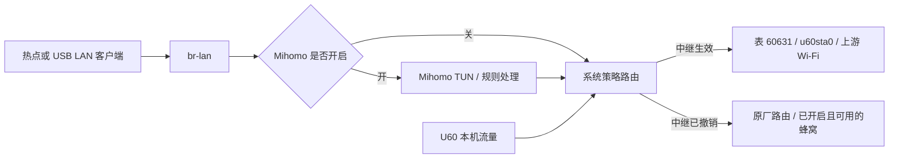

# 中继、蜂窝与热点的切换流程

更新：2026-11-03。适用当前 U60 Pro B31 实现。

## 连接方案

热点操作集中在 `src/wifi_relay/hotspot.rs`，按上游频段只选择一次方案。

| 上游 | 唯一准备方案 | 成功后 | 退出时 |
|---|---|---|---|
| 2.4 GHz | 保存 `wlan0` 运行参数；`disable → set → enable`，切至上游主信道、20 MHz | `u60sta0` 与上游协商自己的带宽；本次 W 为 40 MHz，热点为 20 MHz | 先解除 STA，再恢复原热点参数并启用；SSID、密码、持久信道配置不变 |
| 5 GHz，含 DFS | 保存 `wlan2` 实际主频、带宽、中心频率；确保固件允许切信道；`chan_switch` 至驱动允许的非 DFS 5 GHz 信道、20 MHz | 关联上游，由驱动让热点跟随；本次 W_Game 为 STA/AP 52/160 | 先解除 STA，再按保存值 `chan_switch` 回原热点；等待雷达检测和实际读回确认 |

5 GHz 不再分 DFS 专用连接和非 DFS 直接连接。2.4 GHz 没有采用同一 CSA
方案的实测依据：6/40 → 1/20 成功，但请求恢复 6/40 后实际保持 6/20；
厂商热点重启才恢复 40 MHz。因此保留本机验证过的 disable/set/enable。

扫描、可选网络过滤、连接前检查和 5 GHz 准备信道选择，共用 `scan::Channels`
解析的 PHY 能力。程序不越过驱动的国家/禁用信道限制。

默认保持上游协商带宽，不运行自适应探测、挑战、窄档定时重设。
网页按 SSID＋加密方式保存“保持协商带宽 / 自动调优（实验）”。旧记录默认保持协商带宽，
新连接默认沿用该网络已保存的选择；当前连接修改方案时共用重连流程。网页选择为唯一
运行配置来源，原 `ZTE_AGENT_WIDTH` 环境变量不再覆盖它。
每次新关联仍执行一次已有的宽度复位，清除 B31 跨接口/重连残留的窄档限制。

## 数据路径

- IPv4：先安装上游地址、路由表、NAT、转发保护和 DNS，再加入选路规则，避免
  流量先切到尚未配置完成的接口。局域网管理、Tailnet、本地地址等保留原有路径。
- IPv6：按请求及上游能力配置独立地址/路由、LAN RA/NAT66；缺失时仍可使用
  IPv4。在中继活动期间阻止客户端绕到蜂窝 IPv6。
- DNS：普通 DNS 跟随上游；开启 Mihomo 时保留其拦截优先级；本地管理域名
  仍由本地 DNS 处理。退出时移除中继自己增加的配置，保留原厂内容。
- Mihomo：出口变化后重启其运行实例，保留原来的模式/日志等级，丢弃旧出口的
  长连接和 UDP 状态。撤销中继后，在热点 CAC 前切换出口。
- 蜂窝开关独立于中继。开启蜂窝不会覆盖活动的中继选路；关闭蜂窝也不关闭中继。
  中继退出只释放自己的路由，**不会主动开启蜂窝、发起拨号或改 APN**。如果蜂窝
  未开启、无服务或无有效路由，退出中继后就没有外网。

## 操作与恢复

### 连接或更换上游

1. 校验扫描选择、加密方式、密码及驱动开放信道。无效请求保留当前连接和恢复选择。
2. 接受操作后取消旧的重启恢复任务；使用同一网络锁串行处理扫描/连接/清理。
3. 若已有中继，调用共用清理流程，恢复原热点，再准备新连接。没有另设快速切换路径。
4. 创建独占 `u60sta0`、上游 INPUT 保护和 supplicant；按频段准备热点。
5. 仅扫描选中上游的频率，关联、DHCP、安装路由/NAT/DNS/可选 IPv6。
6. 再次检查取消代次和热点开关；成功后发布会话，保存允许重启恢复的选择。

连接时的“记住网络”保存凭据；“重启后恢复”只指最近一次成功选择，不是所有已保存
网络轮询。手动连接也受取消代次约束，取消后不能发布迟到的成功结果。

### 手动取消/断开中继

清除 `resume.json`，使以后重启也保持中继关闭；已记住的 Wi-Fi 凭据仍可保留。
随后按同一条清理路径执行：

1. 撤销 IPv6、IPv4 中继路由/NAT/保护规则及 DNS/离线门户覆盖。
2. 让 Mihomo 跟随当前可用出口。
3. 停止 DHCP，断开 supplicant，并确认驱动的 STA 已解除关联。
4. 恢复原热点运行参数，再移除漫游设置、专用接口及剩余自有规则和临时文件。

**取消中继通常不会关闭原热点。** 2.4 GHz 恢复原运行信道/能力，5 GHz 恢复
原主频/带宽/中心频率。恢复 36/160 可能需要约 60 秒 CAC；5 GHz 等待每秒查询，
以 80 秒实际时间为截止，每条查询也有超时。失败保留剩余恢复日志供重试。

上游切换也使用这条清理路径，因此某些 5 GHz → 其他网络切换会付出 CAC 的时间。
这是避免增加另一套状态转移及恢复所有权的明确取舍。

### 关闭热点

| 入口 | 行为 |
|---|---|
| 本项目 API/网页修改或关闭热点 | 中继活动或恢复未完成时返回 409，提示先断开/恢复中继；清理后才执行热点设置 |
| 原厂界面、设备控制等直接关 Wi-Fi/相关频段 | watcher 在下一轮检测到明确 OFF，取消恢复选择并清理中继；撤销时跳过已关闭/移除热点的旧快照，不重新启用它 |
| 在连接/雷达等待期间关热点 | 中止正在进行的操作；OFF 使热点快照失效，继续释放其他中继资源 |
| 重新打开热点 | 由原厂配置重新创建热点；之前因 OFF 取消的中继不会自动重连，需要重新选择 |

2.4 GHz 中继依赖匹配的 2.4 GHz 热点以及承载 STA 的 5 GHz 主接口；5 GHz 中继
依赖 5 GHz 主热点。只关闭不相关频段，不主动结束仍可工作的中继。
当前检测依据已提交的开关/接口状态；任意外部工具只改 hostapd 内存而不更新
原厂配置的操作，不等价于已验证的正常关闭入口。

### 上游掉线、agent 重启、整机重启

- **上游掉线/辅助进程退出/租约变化**：watcher 约每 3 秒检查，清理中继并恢复
  原热点。运行中不循环自动重连；保留重启恢复选择，便于之后 agent 重启时尝试。
- **agent 同一开机内重启/升级**：清理残留辅助进程，读取各子系统恢复日志，
  先撤销旧运行状态，再恢复 Mihomo 和最近的上游选择。最多按退避策略尝试约
  17 分钟，手动连接、断开或明确关闭热点会取消重试。
- **整机重启**：日志携带 boot ID；旧开机的运行快照不会覆盖新启动的原厂热点。
  等原厂启动栅栏后，根据保存选择重新扫描和连接。此次没有执行整机冷启动验收。
- **清理中途失败**：已完成的步骤不重做，未完成 undo 留在日志；界面显示
  `recovery_required`，可以再次断开/清理，必要时 USB 执行 `network-recover`。

## 审查与性能取舍

- 删除 DFS/非 DFS 双连接路径，热点操作集中到一个模块；信道事实只解析一次。
- 修正外部 OFF 被恢复覆盖/留下日志、无效请求清除恢复选择、手动连接无法取消、
  长 CAC 延迟出口重绑的问题。保留单一回滚流程，不新增“快速替换”状态机。
- 400 次固定轮数改为实际时间截止；CAC 期间不再每 200 ms 拉起进程。
- 自动窄带试探在 W 上实测导致丢包和 DNS/HTTPS 超时，恢复 40 MHz 即正常；默认
  保持协商带宽。实验调优实现保留但不进入默认数据路径。
- 单频扫描、DFS 切换开关、一次性宽度复位、持久 undo 日志分别有驱动实测和
  崩溃恢复依据，删除会重新引入已复现故障。
- Strict Clippy 被仓库其他模块既有告警阻塞；此次中继改动没有新增 Clippy 诊断。

真机结果及范围见 [2026-11-03 验收记录](2026-11-03-dfs-acceptance.md)。本次证明
设备自身联网，不宣称已完成全部信道、冷启动、雷达事件或下游满载吞吐测试。
